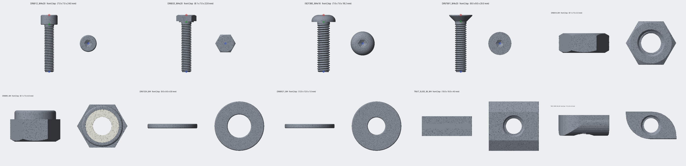

# 02 partgen

Turns every catalogue part into 3D assets that BlenderProc can load. It runs in normal Python
(numpy, trimesh, [manifold3d](https://github.com/elalish/manifold) for robust booleans, Pillow for
previews), not inside Blender.

- **Inputs:** `configs/catalogue.yaml` (tool 01) and the `partgen` section of `configs/config.yaml`
- **Outputs:** `data/assets/<part_id>/` for every enabled part, plus [contact_sheet.png](contact_sheet.png)
- **Guide:** [docs/prompts/02_partgen.txt](../../docs/prompts/02_partgen.txt)

**Status: done.** All 347 enabled parts build and pass every check. At `lod: med` they range from
2k to 62k triangles (median 24k).



## Usage

```bash
pip install -e ".[catalogue,partgen]"
screwsynth-partgen build --all                 # incremental; unchanged parts are skipped
screwsynth-partgen build --family DIN912 --lod high --force
screwsynth-partgen build --id DIN912_M4x16 DIN934_M4
screwsynth-partgen check --all                 # re-run the checks on existing assets
screwsynth-partgen preview --id DIN912_M4x16   # regenerate preview.png
screwsynth-partgen contact-sheet               # tools/partgen/contact_sheet.png (one M4 part per family)
screwsynth-partgen clean [--orphans]           # delete generated folders (--orphans: only disabled/removed parts)
```

`build` prints a summary: parts built, skipped and failed, plus triangle counts. A build is skipped when `part.json`
has the same catalogue hash, generator version and LOD, all four files exist, and its checks passed. Any change to
a part's dimensions in the catalogue therefore triggers a rebuild. After changing builder code, bump
`GENERATOR_VERSION` in `assets.py` or use `--force`.

`--all` uses `partgen.workers` processes (0 = min(4, CPUs)). If worker processes cannot start, for example
because Windows is out of commit memory with large applications open, the build continues in a single process.
Use `--workers 1` to force this. A full serial build of 347 parts takes about 2.5 minutes.

## Output per part (`data/assets/<part_id>/`)

| File | Contents |
|---|---|
| `render.ply` | Detailed mesh in mm. Watertight, manifold, outward normals. Faces are sorted by material slot. |
| `collision.obj` | Compound collision proxy. Each `o piece_<i>` is one low-poly convex piece, with no threads and fewer than 500 triangles in total. |
| `part.json` | Id, class, family, size, length, pitch, dimensions, finishes, keypoints, nominal length, mesh stats, bounding box, centre of mass, material slots, collision stats, check results, generator version, LOD and catalogue hash. |
| `preview.png` | Orthographic front and top views at the same scale. Screw keypoints are circled: head_top red, bearing green, tip blue. |

Material slots: `part.json → mesh.material_slots` maps a slot name to the face range `[first, end)` in
`render.ply`. Slots are `body`, plus `insert` (the nylon ring) for DIN 985. Tool 05 applies finishes per slot.

`axis_height_when_lying` is informational only: roughly, the axis height above the plate at the head and at the
tip when the screw lies on its side. Tool 04 computes the exact values per rest pose.

## Local frame

- **Screws:** the axis is along +z. The bearing face (underside of the head) is at z = 0, the head points to +z
  and the tip to -z.
  - Keypoints: `head_top` = (0, 0, k), `bearing` = (0, 0, 0), `tip` = (0, 0, -L).
- **Countersunk (DIN 7991):** z = 0 is where the cone meets the shank, and `head_top` is the top face at z = k.
  The nominal length includes the head, so `tip` = (0, 0, k - L) and head_top-to-tip = L.
- **Hex heads and nuts:** the corners lie on ±x and the flats face ±y, so across flats = 2·max|y|.
- **Nuts, washers and T-nuts:** centred on the origin (bounding-box centre), with the bore along z. Their keypoints
  are placeholders with `labelled: false`.
- **T-nuts:** length runs along x (the slot direction), width along y, and the neck points to +z.

## Geometry

- **Threads:** a radial height field r(θ, z) over a cylinder, closed with caps, so it is watertight by
  construction.
  - Profile: ISO 68-1 with 60° flanks and a crest flat of p/8. The external depth is h3 = 0.613p.
  - It is a right-hand helix: the profile phase is constant along z/p - θ/2π.
  - The thread runs out over 1.5–2 pitches. The tip has a 45° chamfer starting just below the root diameter.
  - DIN 912 and DIN 7991 lengths above `full_thread_max_length` are threaded over b only, with a plain shank
    above that.
  - The θ = 0 ring samples the crest exactly, so the measured major diameter equals d.
- **Internal threads (nuts, T-nuts):** a tap void with depth 5H/8 = 0.541p (minor diameter D1) is subtracted from
  the body, and the bore ends are countersunk.
- **Heads:**
  - DIN 912: cylinder with chamfers and a hex socket with a 118° drill point.
  - DIN 933: hex prism with a 30° top chamfer and a washer face (dw, c).
  - ISO 7380: dome with a flat top ring and a hex socket.
  - DIN 7991: 90° cone with a hex socket.
- **DIN 934 nuts:** double-chamfered hex.
- **DIN 985 nuts:** hex plus a rounded collar, with the nylon insert ring as a separate slot.
- **Washers:** annulus with rounded edges.
- **T-nuts:** built from the catalogue outline.
  - Slide-in: block with slanted wings and a neck.
  - Drop-in (hammer head): plan shape with two opposite corners rounded, and a rounded bottom.
- **Level of detail:** `partgen.lod_levels` sets `thread_segments` (per turn), `axial_per_pitch` and
  `round_segments`. If a screw's thread would exceed about 85% of `max_triangles` (default 200k), the axial and
  then the angular thread resolution are lowered automatically. M10x80 at `high` is about 110k triangles.

## Checks (run on every build, and by `check`)

- The mesh is watertight, consistently wound, has positive volume, and stays within the triangle budget.
- Dimensions match the catalogue within `tolerance_mm` (0.01):
  - Screws: head top z, overall length, dk (or s and e for hex heads), and thread major diameter.
  - Nuts: height, across flats and thread minor diameter.
  - Washers: d1, d2 and h.
  - T-nuts: length, width and height.
- Keypoint distance equals the nominal length (bearing-to-tip, or head_top-to-tip for DIN 7991).
- The collision proxy has fewer than 500 triangles, every piece is convex, and it contains at least 95% of the
  render-mesh volume. This is computed exactly with a manifold intersection.

## STEP / external CAD parts

A catalogue family with `source: step` (see [the template](../catalogue/templates/family_template.yaml)) is built
from CAD files instead of parameters:

1. **Load the file.** If `cadquery` is installed (`pip install cadquery`), the STEP file is tessellated directly.
   Otherwise, export the STEP file to STL from your CAD program (FreeCAD: select the body > File > Export > STL)
   and save it next to the STEP file with the same name (`foo.step` → `foo.stl`; `.obj` and `.ply` also work).
2. **Scale.** `units` (mm | cm | m | inch) rescales the file to mm.
3. **Align.** For screws, the catalogue keypoints are given in the file's own coordinates. The part is rotated so
   that tip → head_top points to +z, and moved so the bearing lands at the origin, so no axis guessing is needed.
   Other parts take an optional `axis` and are centred on the origin.
4. **Collision proxy.** Built from a convex decomposition when `coacd` is installed (`pip install coacd`).
   Otherwise a single convex hull is used.

Dimension checks are skipped for STEP parts. Mesh validity, keypoints and collision are still checked.

## Adding a builder for a new family

1. In the catalogue, give the family a new `shape` and list its required dimensions in `REQUIRED_DIMS` (and
   `SHAPE_KIND`) in `src/screwsynth/catalogue/schema.py`. Add sanity rules in `validate.py`.
2. In `src/screwsynth/partgen/builders.py`, write `build_<shape>(part, lod, coll_n) -> BuiltPart`:
   - Make the head and body from `_revolve` (an (r, z) profile), `_prism` (an xy polygon extruded along z) and
     manifold booleans (`+` union, `-` difference, `^` intersection).
   - Add threads with `_screw_rod` (external) or `_tap` (an internal void to subtract).
   - For screws, return through `_screw_result` to get the keypoints and a shank collision piece. Return other
     parts through `_simple_result`.
   - To give a separate material slot, call `.as_original()` on that sub-solid before the union, then pass
     `slot_ids` (see `build_nyloc_nut`).
3. Register it in `BUILDERS`. Add the dimension checks in `checks.check_dimensions` and a sample part to
   `tests/partgen/test_partgen.py`.
4. Bump `GENERATOR_VERSION` in `assets.py` so existing assets are rebuilt.
