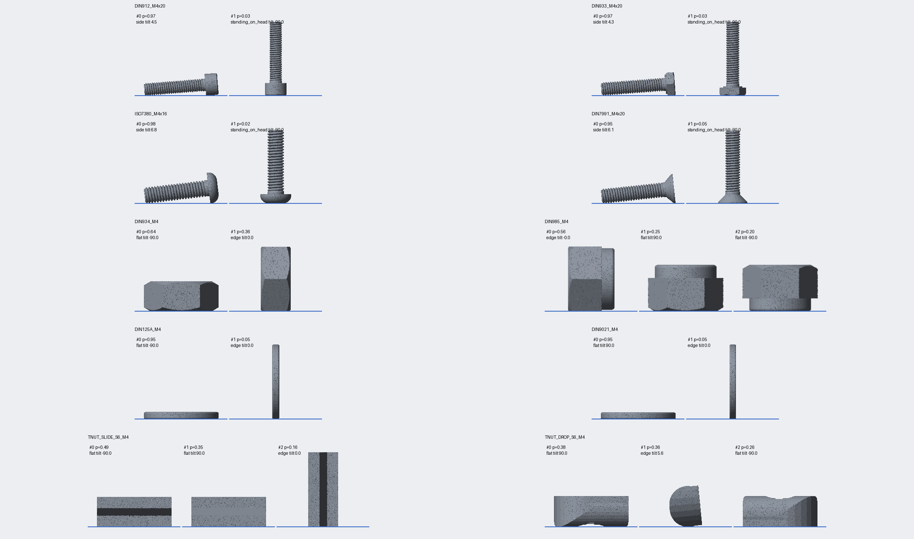

# 04 restposes

Precomputes, once per part, how it naturally rests on a flat plate. Tool 05 then places parts in one of these
poses with a random yaw and only runs a short physics settle, instead of dropping every part from a height. The
axis heights stored here are also what the stage-2 measurement uses for parallax correction.

- **Inputs:** `data/assets/<part_id>/render.ply` and `part.json` (tool 02)
- **Outputs:** `data/rest_poses/<part_id>.json`, plus a [contact sheet](contact_sheet.png)
- **Guide:** [docs/prompts/04_restposes.txt](../../docs/prompts/04_restposes.txt)

**Status: done.** Poses are computed for all 347 enabled parts in about 75 s.



## Method

1. **Stable poses.** `trimesh.poses.compute_stable_poses` runs on the render mesh. It uses the convex hull and
   centre of mass and is quasi-static: the part lands on a hull face and topples until it is stable.
   - With `com_samples: 1` (the default) the probabilities are exact solid angles, so they are deterministic and
     fast.
   - The guide's "2000 samples" refers to Monte-Carlo sampling. Exact mode doesn't need it, and each sample costs
     about 0.08 s per part, which would be hours for the catalogue.
   - Set `com_samples > 1` and `com_sigma_mm > 0` to model an uncertain centre of mass, for example a plated or
     hollow part.
2. **Merge equivalent poses.** Two poses are equivalent if they differ only by:
   - a yaw (rotation about the plate normal), which tool 05 randomises anyway; or
   - a symmetry of the part:
     - continuous roll about the axis for round heads and washers;
     - 6-fold roll for hex heads and nuts;
     - 2-fold roll for T-nuts;
     - a 180° flip for washers and plain hex nuts.

   Probabilities are summed within `merge_tilt_deg`. `roll_symmetry` in the output tells tool 05 that it may also
   randomise the roll.
3. **Threshold and reweight.** Poses below `min_probability` (0.02) are dropped. `overrides` then multiply the
   probability of a category, and everything is renormalised.
4. **Canonical yaw.** Yaw is set so the part axis (or the part's x axis, if the axis is vertical) points along
   +x. The pose is shifted so that the lowest vertex is exactly at z = 0.
5. **Optional validation** (`compute --validate`). The part's convex hull is dropped `validate_drops` times from
   random orientations in pybullet. Each final orientation is matched to a computed pose (yaw and symmetry
   invariant), and the empirical distribution is compared with the computed one. The command reports differences
   above 0.15 and more than 10% unmatched drops. If pybullet is not installed it skips with a warning; there is no
   pybullet wheel for Python 3.12 on Windows, so use Python 3.10/3.11 or Linux for this step.

### Sanity results (default settings)

| Family | Typical result |
|---|---|
| DIN 912 | On its side 94–100%. The tilt matches atan((dk−d)/2/L) within about 0.5°, e.g. M4x16: 5.6° vs 5.4° analytic. Short screws also stand on the head (M3x5: 13%). |
| DIN 933, ISO 7380 | On the side, resting on the head rim and the thread crests. ISO 7380 tilts more (up to 23°) because of its large dome. |
| DIN 7991 | Rocks on the cone: on its side at 3–26°, so fewer of its poses are measurable. |
| DIN 934 | Flat about 64%, on an edge about 36%. |
| DIN 985 | On edge, or flat on either face (the collar breaks the flip symmetry). |
| Washers | Flat about 95%, on edge about 5%. Set an override to remove the edge pose if your parts are spread by hand. |
| T-nuts | Flat, plus edge poses. Drop-in nuts rock on their rounded bottom. |

Run `screwsynth-restposes summary` for the full table per family.

## Output: `data/rest_poses/<part_id>.json`

```json
{
  "part_id": "DIN912_M4x16", "kind": "screw", "shape": "socket_cap",
  "roll_symmetry": "continuous", "flip_symmetric": false,
  "poses": [
    {
      "index": 0,
      "transform": [[...4x4: part local frame -> plate frame, mm...]],
      "probability": 0.96, "raw_probability": 0.96,
      "category": "side",
      "axis_tilt_deg": 5.6,
      "keypoint_heights_mm": {"head_top": 3.41, "bearing": 3.5, "tip": 1.94},
      "axis_height_head_mm": 3.5, "axis_height_tip_mm": 1.94,
      "measurable": true, "merged_raw_poses": 70
    }
  ],
  "method": {"com_samples": 1, "min_probability": 0.02, "overrides": [], "...": "..."},
  "catalogue_hash": "...", "generator_version": "1"
}
```

- `axis_tilt_deg` is the elevation of the part's +z axis (towards the head) above the plate. A positive value
  means the head is higher; -90 means standing on the head.
- `keypoint_heights_mm` are the plate-frame z values of the three keypoints, which all lie on the screw axis.
  `axis_height_head_mm` is the height at the bearing and `axis_height_tip_mm` the height at the tip. These are
  stored at full precision for the parallax correction in tool 08.
- `measurable` is true for screws with |tilt| ≤ `measurable_tilt_deg` (15°).
- Categories:
  - Screws: `side`, `standing_on_head` (tilt < −60°), `standing_on_tip` (tilt > 60°).
  - Other parts: `flat` (|tilt| > 60°), `edge`.

## Config (`restposes` in `configs/config.yaml`)

| Key | Default | Meaning |
|---|---|---|
| `com_samples` / `com_sigma_mm` | 1 / 0 | Centre-of-mass perturbation samples. 1 = exact |
| `min_probability` | 0.02 | Drop rarer poses, then renormalise |
| `merge_tilt_deg` | 1.0 | Tilt tolerance when merging equivalent poses |
| `measurable_tilt_deg` | 15 | Maximum screw axis tilt that counts as measurable |
| `validate_drops` | 50 | Drops per part for `--validate` |
| `overrides` | `[]` | List of `{match, category, weight}` entries |

Overrides adjust the physics to how parts are actually spread on the plate, by hand or by machine. `match` is a
glob on the part id, class or family; the last matching entry wins, and weight 0 removes the category:

```yaml
overrides:
  - {match: "DIN912*", category: standing_on_head, weight: 0}   # never standing on the head
  - {match: "DIN125A*", category: edge, weight: 0}              # washers always flat
  - {match: "DIN934*", category: edge, weight: 0.5}             # halve nuts on edge
```

## CLI: `screwsynth-restposes`

```bash
screwsynth-restposes compute --all            # incremental (catalogue hash, asset version, settings)
screwsynth-restposes compute --id DIN912_M4x16 --validate
screwsynth-restposes show --id DIN912_M3x5    # data/rest_poses/DIN912_M3x5.png, one tile per pose
screwsynth-restposes summary                  # table per family
screwsynth-restposes contact-sheet            # tools/restposes/contact_sheet.png
```
